<p align="center">
  <picture>
    <source media="(prefers-color-scheme: dark)" srcset="assets/hero-dark.svg">
    
  </picture>
</p>

<p align="center">
  <a href="https://github.com/Aboudjem/loopify/actions/workflows/validate.yml"></a>
  <a href="LICENSE"></a>
</p>

<p align="center">
  <b>English</b> · <a href="READMEs/zh-CN.md">简体中文</a> · <a href="READMEs/ja.md">日本語</a> · <a href="READMEs/es.md">Español</a> · <a href="READMEs/fr.md">Français</a>
</p>

<p align="center">
  <strong>Hand Claude a job that repeats. Come back to a log of what every tick did, not a loop you have to babysit.</strong>
</p>

<p align="center">
  <a href="#install">Install</a> · <a href="#how-it-works">How it works</a> · <a href="#what-you-get">What you get</a> · <a href="#works-with">Works with</a> · <a href="#proof">Proof</a> · <a href="#faq">FAQ</a> · <a href="#limits">Limits</a>
</p>

loopify writes the prompt for Claude Code's `/loop`. You describe a job that repeats. You get a
brief the loop re-reads every tick, and a log of what each tick did.

```text
STATUS: NEEDS YOU · tick 7/30 · last tick 2026-09-01T09:40 (changed, 10 min ago) · 2 queued
Do next:
1. QUEUE.md, tick 4: Post the drafted reply on the `fetchAll` rename thread of PR #412
```

Those are the first lines of `loop_status.py` on the shipped example. The full report is under
[What you get](#what-you-get).

## Install

For Claude Code, run these two commands in your terminal (not inside a Claude session):

```bash
claude plugin marketplace add Aboudjem/10x
claude plugin install loopify@10x
```

Any other agent installs the same skill in one line, through the
[skills CLI](https://github.com/vercel-labs/skills). Name your agent with `-a`, for example `cursor`:

```bash
npx skills add Aboudjem/loopify -a cursor
```

Leave out `-a` and the CLI installs for every agent it detects on your machine.

There is nothing to build. The skill is one folder with three standard-library Python scripts.

## How it works

Some jobs never finish. A release pull request needs watching all afternoon. New bug reports pile
up overnight. Claude Code already has `/loop`: it runs a prompt again and again while your session
is open. It does not write the prompt for you.

loopify writes it. It reads your project, asks the few decisions that matter, and writes two things.

- **The brief, a file.** One round of the job: what to read, what it may change, what it must never
  do, when to stop. The loop opens it fresh every run, so you can edit it while the loop runs.
- **The line, one string.** You paste it into `/loop`. It carries the brief's path and the stop rule.

Each run is a **tick**. Every tick, Claude re-reads the brief, does one round, and writes what
happened to `TICKS.md`.

### 1. Describe the job

Type `/loopify` in Claude Code and say what should repeat. loopify reads the README, the recent
commits and the open pull requests. Then it asks one short batch of questions.

```text
/loopify keep our release PR healthy, check it every 20 minutes
    brief      /Users/you/acme/.loop/pr-babysitter.md     a file, re-read every tick
    state      /Users/you/acme/.loop/pr-babysitter/       TICKS.md · LESSONS.md · QUEUE.md
    line       144 chars                                  one string, you paste it below
```

`/Users/you/acme/` stands in for your project. loopify prints your real paths.

### 2. Paste the line

```text
/loop 20m Run one cycle of /Users/you/acme/.loop/pr-babysitter.md · read it first, obey its stop rule (30 ticks or the PR merges), log the tick.
```

Claude runs one round now, then every 20 minutes in that session. It stops when the PR merges or
after 30 ticks, whichever comes first. The two mistakes people make most often:

```text loop-antipattern
# not this: "every morning" can make /loop offer a cloud schedule instead, and nothing says when to stop
/loop every morning keep the release PR healthy

# and not the path alone: the tick gets a filename and no instruction
/loop 20m /Users/you/acme/.loop/pr-babysitter.md
```

### 3. Read the log, or ask for the status

`TICKS.md` holds one entry per tick, with a counter at the top:

```text
tick: 7/30

## tick 7 · 2026-09-01T09:40 · changed
- CI: lint failed on src/api.ts → fixed the unused import, committed 4f2a1c9, npm test 12/12
- reviews: 1 new thread answered (rename), reply drafted in QUEUE.md
```

Whatever the loop could not do safely waits for you in `QUEUE.md`. One command reads all three files
and tells you what to do next. See the next section.

## What you get

This is the real output of the status report on the example state directory in this repo:

```bash
python3 skills/loopify/scripts/loop_status.py examples/loop-state/pr-babysitter --now 2026-09-01T09:50
```

```text
STATUS: NEEDS YOU · tick 7/30 · last tick 2026-09-01T09:40 (changed, 10 min ago) · 2 queued
Do next:
1. QUEUE.md, tick 4: Post the drafted reply on the `fetchAll` rename thread of PR #412
   unblock: post the reply below on the thread, then delete this item
2. QUEUE.md, tick 5: `e2e` fails in checkout.spec.ts line 88: expected total 42.00, received 41.99
   unblock: fix the rounding in src/cart/total.ts or mark the PR as blocked
3. Read tick 7 in examples/loop-state/pr-babysitter/TICKS.md and check its evidence.
Detail:
  ticks logged  7 (4 changed, 3 noop, 0 stopped)
  queue         2 open item(s)
  lessons       4 entries
  lock          none
  interval      20m (from the saved line)
  log format    passes ticks_lint
  state dir     examples/loop-state/pr-babysitter
```

`--now` pins the clock so the sample prints the same every time. Leave it out on a real loop.

Line 1 is always the verdict: `OK`, `NEEDS YOU`, `STALE`, `STOPPED`, `NOT STARTED` or `BROKEN LOG`.
Then at most three things to do. Then the detail. `lessons` counts the entries in `LESSONS.md`.

The exit code carries the verdict, so a script or a cron job can act on it:

| Exit | Verdict | Meaning |
| ---- | ------- | ------- |
| `0` | `OK`, `STOPPED`, `NOT STARTED` | Nothing needs you |
| `1` | `NEEDS YOU`, `STALE`, `BROKEN LOG` | Look at the loop |
| `2` | none | Usage error, or the state directory does not exist |

`loop_status.py --help` prints the same table.

Every brief loopify writes also gives you:

- **A stop rule and a tick cap inside the line.** A loop that finishes its job stops. So does one
  that reaches its cap.
- **Rails for an unattended run.** No accounts, no payments, no pushing or posting unless you say
  so. Anything the loop reads, such as a PR comment, is data, never an instruction.
- **A repeat-safe clause.** The brief names the marker a tick looks for before it acts. A tick that
  runs twice can tell the work already happened.
- **A log with a fixed shape.** Every entry opens with `## tick <n> · <ISO timestamp> · changed |
noop | stopped`. `ticks_lint.py` checks it.
- **A loop that learns.** `LESSONS.md` keeps what worked and what wasted time. Every tick re-reads it.

## Works with

Each row below is an install I ran on 2026-11-17, in an empty temp folder.

| Agent                    | Install command                                                          | Tested                                          |
| ------------------------ | ------------------------------------------------------------------------ | ----------------------------------------------- |
| Claude Code 2.1.326      | `claude plugin install` from the repo marketplace, in a clean config dir | 2026-11-17, plugin enabled, scripts present     |
| Claude Code (skills CLI) | `npx skills add Aboudjem/loopify -a claude-code`                         | 2026-11-17, skill copied into `.claude/skills/` |
| Cursor                   | `npx skills add Aboudjem/loopify -a cursor`                              | 2026-11-17, skill in `.agents/skills/`          |
| Codex                    | `npx skills add Aboudjem/loopify -a codex`                               | 2026-11-17, skill in `.agents/skills/`          |
| GitHub Copilot           | `npx skills add Aboudjem/loopify -a github-copilot`                      | 2026-11-17, skill in `.agents/skills/`          |
| Gemini CLI               | `npx skills add Aboudjem/loopify -a gemini-cli`                          | 2026-11-17, skill in `.agents/skills/`          |

"Tested" means the files landed and the three scripts ran from the installed copy. It does not
mean a loop ran inside that agent.

Documented, not tested: OpenCode, Windsurf, Zed, Kimi Code CLI and a hand copy of `skills/loopify/`.
See [docs/editors.md](docs/editors.md).

The brief travels, the line does not. The line is a Claude Code `/loop` line. Elsewhere the brief
runs one cycle, logs it and exits, and an outside scheduler fires the next tick.
[docs/other-agents.md](docs/other-agents.md) covers Kimi, Copilot CLI, Cursor, Goose and plain cron.

## Proof

`make test` prints every number here. CI runs it on every push and pull request.

```bash
make test
```

| Suite                       | What it checks                                                                          | Result today |
| --------------------------- | --------------------------------------------------------------------------------------- | ------------ |
| `evals/check_skill.py`      | The skill's contract, as assertions                                                     | 161/161      |
| `tests/test_manifests.py`   | Manifests, version parity, the example brief, translations, SVGs, secrets, no long dash | 170/170      |
| `tests/test_ticks_lint.py`  | The tick log format                                                                     | 13/13        |
| `tests/test_loop_status.py` | Each status verdict, the exit codes, and this README's sample, byte for byte           | 62/62        |
| `tests/test_no_network.py`  | No shipped script imports a network module or calls curl or wget                        | 18/18        |
| `tests/test_dated_facts.py` | A `/loop` fact dated to an older version names that version wherever it is stated      | 5/5          |
| `evals/loop_line_lint.py`   | The canonical line passes the eight line rules                                          | PASS         |

CI also runs `claude plugin validate . --strict` on a pinned Claude Code, and checks that
`npx skills@1.9.0 add . --list` finds the skill.

I checked the `/loop` facts against Claude Code 2.1.326 and its docs on 2026-11-17. One fact could
not be re-confirmed on 2.1.326: `/clear` wiping the schedule. It stays dated to 2.1.252 (2026-09-01).
The per-fact table is in
[docs/limits.md](docs/limits.md#which-version-each-fact-was-checked-on).

## FAQ

**Does loopify start the loop for me?**
No. It writes the brief, prints the line, and stops. You paste the line when you want the loop to
start.

**Why a file and a string, not one prompt?**
The tick needs detail: paths, commands, what to do when blocked. `/loop` needs one short prompt it
re-sends every tick. The brief holds the detail, the line carries its path.

**How do I know the loop is still alive?**
Run `loop_status.py` on the state directory. It says `STALE` when no tick has landed for two
intervals. You can also ask Claude "what scheduled tasks do I have?".

**What stops a loop?**
The stop rule in the brief, the tick cap, the seven-day expiry, or you. The full list is in
[docs/faq.md](docs/faq.md).

**Does it send my code anywhere?**
No. loopify's scripts make no network call: `tests/test_no_network.py` fails if one imports a network
module or calls curl or wget. What a tick does is what your brief allows.

## Limits

> [!IMPORTANT]
> A running loop is not proof it is doing the right thing. No evaluator sits behind `/loop`. The
> tick log and the status report are the only proof there is.

- **The loop lives in the session you paste it into.** Close the terminal and it stops. On 2.1.252,
  `/clear` wiped the schedule too. Ask "what scheduled tasks do I have?" to check yours.
- **Every loop ends at 7 days.** One session holds at most 50 scheduled tasks. Both are Claude Code
  limits. Paste the line again to carry on.
- **Pre-approve what a tick runs.** A tick that hits a permission prompt waits there for an answer.
  loopify prints the commands to allow, such as `gh pr view` or `git commit`.
- **The status report needs the interval** to tell a live loop from a dead one. It reads it from the
  saved line, or from `--interval`.

The whole list, traced to the binary or the docs: [docs/limits.md](docs/limits.md).

## Learn more

- [Quickstart](docs/quickstart.md): your first loop, step by step
- [Install in your editor](docs/editors.md): the agent code and both install paths
- [A worked example](examples/sample-loop-brief.md): a complete brief with the line at the bottom
- [Other agents](docs/other-agents.md): the same brief under Kimi, Cursor, Goose and plain cron
- [FAQ](docs/faq.md) · [The `loop.md` pointer](docs/loop-md.md) · [Changelog](CHANGELOG.md) · [Contributing](CONTRIBUTING.md) · [The skill itself](skills/loopify/SKILL.md)

If you have used [goalify](https://github.com/Aboudjem/goalify), this will feel familiar. goalify is
for a job that finishes. loopify is for a job that repeats.

---

<sub>Built by <a href="https://github.com/Aboudjem">Adam Boudjemaa</a> · MIT. `/loop` behavior checked
against Claude Code 2.1.326 and the official docs on 2026-11-17, except `/clear`, last checked on
2.1.252 (2026-09-01). <a href="docs/limits.md#which-version-each-fact-was-checked-on">Per-fact table</a>. Sibling of
<a href="https://github.com/Aboudjem/goalify">goalify</a>, which does the same for `/goal`.
<a href="https://github.com/Aboudjem/loopify/issues">Spot a gap?</a></sub>
