<p align="center">
  <picture>
    <source media="(prefers-color-scheme: dark)" srcset="https://raw.githubusercontent.com/Aboudjem/loopify/main/assets/hero-dark.svg">
    
  </picture>
</p>

<p align="center">
  <a href="https://github.com/Aboudjem/loopify/actions/workflows/validate.yml"></a>
  <a href="https://github.com/Aboudjem/loopify/blob/main/LICENSE"></a>
</p>

<p align="center">
  <a href="../README.md">English</a> · <a href="zh-CN.md">简体中文</a> · <a href="ja.md">日本語</a> · <b>Español</b> · <a href="fr.md">Français</a>
</p>

<p align="center">
  <strong>Dale a Claude un trabajo que se repite. Vuelve a un registro de lo que hizo cada tick, no a un bucle que tienes que vigilar.</strong>
</p>

<p align="center">
  <a href="#instalación">Instalación</a> · <a href="#cómo-funciona">Cómo funciona</a> · <a href="#qué-obtienes">Qué obtienes</a> · <a href="#compatibilidad">Compatibilidad</a> · <a href="#pruebas">Pruebas</a> · <a href="#preguntas-frecuentes">Preguntas frecuentes</a> · <a href="#límites">Límites</a>
</p>

<p align="center"><sub>Esta traducción puede ir por detrás del original en inglés.<!-- may-lag --></sub></p>

loopify escribe el prompt para el `/loop` de Claude Code. Describes un trabajo que se repite.
Obtienes un brief que el bucle relee en cada tick, y un registro de lo que hizo cada tick.

```text
STATUS: NEEDS YOU · tick 7/30 · last tick 2026-09-01T09:40 (changed, 10 min ago) · 2 queued
Do next:
1. QUEUE.md, tick 4: Post the drafted reply on the `fetchAll` rename thread of PR #412
```

Son las primeras líneas de `loop_status.py` sobre el ejemplo incluido. El informe completo está en
[Qué obtienes](#qué-obtienes).

## Instalación

En Claude Code, ejecuta estos dos comandos:

```bash
claude plugin marketplace add Aboudjem/10x
claude plugin install loopify@10x
```

Cualquier otro agente instala el mismo skill en una línea, con la
[CLI de skills](https://github.com/vercel-labs/skills):

```bash
npx skills add Aboudjem/loopify
```

No hay nada que compilar. El skill es una carpeta con tres scripts de Python de biblioteca estándar.

## Cómo funciona

Algunos trabajos no terminan nunca. Un pull request de release hay que vigilarlo toda la tarde.
Los bugs nuevos se acumulan de noche. Claude Code ya tiene `/loop`: repite un prompt mientras la
sesión sigue abierta. No escribe el prompt por ti.

loopify lo escribe. Lee tu proyecto, pregunta las pocas decisiones que importan y escribe dos cosas.

- **El brief, un archivo.** Una vuelta del trabajo: qué leer, qué puede cambiar, qué no debe hacer
  nunca, cuándo parar. El bucle lo abre de nuevo en cada vuelta, así que puedes editarlo en marcha.
- **La línea, una sola cadena.** La pegas en `/loop`. Lleva la ruta del brief y la regla de parada.

Cada vuelta es un **tick**. En cada tick, Claude relee el brief, hace una vuelta y anota lo que pasó
en `TICKS.md`.

### 1. Describe el trabajo

Escribe `/loopify` en Claude Code y di qué debe repetirse. loopify lee el README, los commits
recientes y los pull requests abiertos. Luego hace una tanda corta de preguntas.

```text
/loopify keep our release PR healthy, check it every 20 minutes
    brief      /Users/you/acme/.loop/pr-babysitter.md     a file, re-read every tick
    state      /Users/you/acme/.loop/pr-babysitter/       TICKS.md · LESSONS.md · QUEUE.md
    line       144 chars                                  one string, you paste it below
```

`/Users/you/acme/` representa tu proyecto. loopify muestra tus rutas reales.

### 2. Pega la línea

```text
/loop 20m Run one cycle of /Users/you/acme/.loop/pr-babysitter.md · read it first, obey its stop rule (30 ticks or the PR merges), log the tick.
```

Claude hace una vuelta ya, y luego cada 20 minutos en esa sesión. Para cuando el PR se fusiona o
tras 30 ticks, lo que ocurra primero. Los dos errores más comunes:

```text loop-antipattern
# not this: "every morning" can make /loop offer a cloud schedule instead, and nothing says when to stop
/loop every morning keep the release PR healthy

# and not the path alone: the tick gets a filename and no instruction
/loop 20m /Users/you/acme/.loop/pr-babysitter.md
```

### 3. Lee el registro, o pide el estado

`TICKS.md` tiene una entrada por tick, con un contador arriba:

```text
tick: 7/30

## tick 7 · 2026-09-01T09:40 · changed
- CI: lint failed on src/api.ts → fixed the unused import, committed 4f2a1c9, npm test 12/12
- reviews: 1 new thread answered (rename), reply drafted in QUEUE.md
```

Lo que el bucle no pudo hacer de forma segura te espera en `QUEUE.md`. Un comando lee los tres
archivos y te dice qué hacer. Mira la siguiente sección.

## Qué obtienes

Esta es la salida real del informe de estado sobre la carpeta de ejemplo de este repo:

```bash
python3 skills/loopify/scripts/loop_status.py examples/loop-state/pr-babysitter --now 2026-09-01T09:50
```

```text
STATUS: NEEDS YOU · tick 7/30 · last tick 2026-09-01T09:40 (changed, 10 min ago) · 2 queued
Do next:
1. QUEUE.md, tick 4: Post the drafted reply on the `fetchAll` rename thread of PR #412
   unblock: post the reply below on the thread, then delete this item
2. QUEUE.md, tick 5: `e2e` fails in checkout.spec.ts line 88: expected total 42.00, received 41.99
   unblock: fix the rounding in src/cart/total.ts or mark the PR as blocked
3. Read tick 7 in examples/loop-state/pr-babysitter/TICKS.md and check its evidence.
Detail:
  ticks logged  7 (4 changed, 3 noop, 0 stopped)
  queue         2 open item(s)
  lessons       5 line(s)
  lock          none
  interval      20m (from the saved line)
  log format    passes ticks_lint
  state dir     examples/loop-state/pr-babysitter
```

`--now` fija el reloj para que el ejemplo salga siempre igual. No lo uses en un bucle real.

La línea 1 es siempre el veredicto: `OK`, `NEEDS YOU`, `STALE`, `STOPPED`, `NOT STARTED` o
`BROKEN LOG`. Luego tres acciones como máximo. Luego el detalle.

Cada brief que escribe loopify también te da:

- **Una regla de parada y un tope de ticks dentro de la línea.** Un bucle que termina su trabajo
  para. También el que llega a su tope.
- **Barreras para correr sin vigilancia.** Sin cuentas, sin pagos, sin push ni publicaciones salvo
  que lo digas. Lo que el bucle lee, como un comentario de PR, es un dato, nunca una instrucción.
- **Una cláusula de repetición segura.** El brief nombra la marca que un tick busca antes de actuar.
  Un tick que corre dos veces ve que el trabajo ya está hecho.
- **Un registro con formato fijo.** Cada entrada empieza con `## tick <n> · <ISO timestamp> · changed |
noop | stopped`. `ticks_lint.py` lo comprueba.
- **Un bucle que aprende.** `LESSONS.md` guarda lo que funcionó y lo que hizo perder tiempo.

## Compatibilidad

Cada fila es una instalación que hice el 2026-11-17, en una carpeta temporal vacía.

| Agente                      | Comando de instalación                                               | Probado                                         |
| --------------------------- | -------------------------------------------------------------------- | ----------------------------------------------- |
| Claude Code 2.1.326         | `claude plugin install` desde el marketplace del repo, config limpia | 2026-11-17, plugin activo, scripts presentes    |
| Claude Code (CLI de skills) | `npx skills add Aboudjem/loopify -a claude-code`                     | 2026-11-17, skill enlazado en `.claude/skills/` |
| Cursor                      | `npx skills add Aboudjem/loopify -a cursor`                          | 2026-11-17, skill en `.agents/skills/`          |
| Codex                       | `npx skills add Aboudjem/loopify -a codex`                           | 2026-11-17, skill en `.agents/skills/`          |
| GitHub Copilot              | `npx skills add Aboudjem/loopify -a github-copilot`                  | 2026-11-17, skill en `.agents/skills/`          |
| Gemini CLI                  | `npx skills add Aboudjem/loopify -a gemini-cli`                      | 2026-11-17, skill en `.agents/skills/`          |

"Probado" significa que los archivos llegaron y los tres scripts corren desde la copia instalada. No
significa que un bucle corrió dentro de ese agente.

Documentados, sin probar: OpenCode, Windsurf, Zed, Kimi Code CLI y la copia a mano de
`skills/loopify/`. Mira [docs/editors.md](https://github.com/Aboudjem/loopify/blob/main/docs/editors.md).

El brief viaja, la línea no. La línea es una línea `/loop` de Claude Code. En otros sitios el brief
hace una vuelta, la anota y sale, y un planificador externo lanza el siguiente tick.
[docs/other-agents.md](https://github.com/Aboudjem/loopify/blob/main/docs/other-agents.md) cubre
Kimi, Copilot CLI, Cursor, Goose y cron.

## Pruebas

`make test` imprime cada número de abajo. La CI lo ejecuta en cada push y pull request.

```bash
make test
```

| Suite                       | Qué comprueba                                                                         | Resultado |
| --------------------------- | ------------------------------------------------------------------------------------- | --------- |
| `evals/check_skill.py`      | El contrato del skill, como aserciones                                                | 160/160   |
| `tests/test_manifests.py`   | Manifiestos, versiones, brief de ejemplo, traducciones, SVG, secretos, guiones largos | 170/170   |
| `tests/test_ticks_lint.py`  | El formato del registro de ticks                                                      | 13/13     |
| `tests/test_loop_status.py` | Cada veredicto, y el ejemplo del README byte a byte                                   | 51/51     |
| `evals/loop_line_lint.py`   | La línea canónica pasa las ocho reglas                                                | PASS      |

La CI también ejecuta `claude plugin validate . --strict` sobre un Claude Code fijado, y comprueba
que `npx skills@1.9.0 add . --list` encuentra el skill.

Los datos de `/loop` vienen del binario de Claude Code 2.1.252 y de la documentación. El rastro está
en [docs/limits.md](https://github.com/Aboudjem/loopify/blob/main/docs/limits.md).

## Preguntas frecuentes

**¿loopify arranca el bucle por mí?**
No. Escribe el brief, muestra la línea y se detiene. Tú pegas la línea cuando quieres empezar.

**¿Por qué un archivo y una cadena, y no un solo prompt?**
El tick necesita detalle: rutas, comandos, qué hacer si algo se bloquea. `/loop` necesita un prompt
corto que reenvía en cada tick. El brief guarda el detalle y la línea lleva su ruta.

**¿Cómo sé si el bucle sigue vivo?**
Ejecuta `loop_status.py` sobre la carpeta de estado. Dice `STALE` cuando no llega ningún tick en dos
intervalos. También puedes preguntar a Claude "what scheduled tasks do I have?".

**¿Qué detiene un bucle?**
La regla de parada del brief, el tope de ticks, la caducidad de siete días, o tú. La lista completa
está en [docs/faq.md](https://github.com/Aboudjem/loopify/blob/main/docs/faq.md).

**¿Envía mi código a algún sitio?**
No. loopify y sus scripts no hacen ninguna llamada de red. Un tick hace lo que tu brief permite.

## Límites

> [!IMPORTANT]
> Que un bucle corra no prueba que haga lo correcto. No hay evaluador detrás de `/loop`. El
> registro de ticks y el informe de estado son la única prueba.

- **El bucle vive en la sesión donde lo pegas.** Cierra la terminal y se detiene. `/clear` borra
  también la programación.
- **Todo bucle termina a los 7 días.** Una sesión admite como mucho 50 tareas programadas. Son
  límites de Claude Code. Vuelve a pegar la línea para seguir.
- **Aprueba de antemano lo que ejecuta un tick.** Un tick que topa con una petición de permiso
  espera una respuesta. loopify muestra los comandos a permitir, como `gh pr view` o `git commit`.
- **El informe de estado necesita el intervalo** para distinguir un bucle vivo de uno muerto. Lo lee
  de la línea guardada o de `--interval`.

La lista completa, con fuentes: [docs/limits.md](https://github.com/Aboudjem/loopify/blob/main/docs/limits.md).

## Más información

- [Inicio rápido](https://github.com/Aboudjem/loopify/blob/main/docs/quickstart.md): tu primer bucle, paso a paso
- [Instalar en tu editor](https://github.com/Aboudjem/loopify/blob/main/docs/editors.md): el código de agente y las dos vías
- [Un ejemplo completo](https://github.com/Aboudjem/loopify/blob/main/examples/sample-loop-brief.md): un brief entero con la línea al final
- [Otros agentes](https://github.com/Aboudjem/loopify/blob/main/docs/other-agents.md): el mismo brief con Kimi, Cursor, Goose y cron
- [FAQ](https://github.com/Aboudjem/loopify/blob/main/docs/faq.md) · [El puntero `loop.md`](https://github.com/Aboudjem/loopify/blob/main/docs/loop-md.md) · [Changelog](https://github.com/Aboudjem/loopify/blob/main/CHANGELOG.md) · [Contribuir](https://github.com/Aboudjem/loopify/blob/main/CONTRIBUTING.md) · [El skill](https://github.com/Aboudjem/loopify/blob/main/skills/loopify/SKILL.md)

Si has usado [goalify](https://github.com/Aboudjem/goalify), esto te resultará familiar. goalify es
para un trabajo que termina. loopify es para un trabajo que se repite.

---

<sub>Hecho por <a href="https://github.com/Aboudjem">Adam Boudjemaa</a> · MIT. El comportamiento de `/loop` se
volvió a derivar del binario de Claude Code 2.1.252 y de la documentación oficial. Hermano de
<a href="https://github.com/Aboudjem/goalify">goalify</a>, que hace lo mismo para `/goal`.
<a href="https://github.com/Aboudjem/loopify/issues">¿Ves algo que falta?</a></sub>

<sub>Traducción asistida por máquina y revisada. La versión de referencia es el <a href="../README.md">README.md</a> en inglés.</sub>
