<p align="center">
  <picture>
    <source media="(prefers-color-scheme: dark)" srcset="https://raw.githubusercontent.com/Aboudjem/loopify/main/assets/hero-dark.svg">
    
  </picture>
</p>

<p align="center">
  <a href="https://github.com/Aboudjem/loopify/actions/workflows/validate.yml"></a>
  <a href="https://github.com/Aboudjem/loopify/blob/main/LICENSE"></a>
</p>

<p align="center">
  <a href="../README.md">English</a> · <a href="zh-CN.md">简体中文</a> · <a href="ja.md">日本語</a> · <a href="es.md">Español</a> · <b>Français</b>
</p>

<p align="center"><strong>Vérifiez une tâche d'agent qui se répète, en une ligne.</strong></p>

<p align="center">
  <a href="#installation">Installation</a> · <a href="#comment-ça-marche">Comment ça marche</a> · <a href="#ce-que-vous-obtenez">Ce que vous obtenez</a> · <a href="#compatibilité">Compatibilité</a> · <a href="#preuves">Preuves</a> · <a href="#faq">FAQ</a> · <a href="#limites">Limites</a>
</p>

<p align="center"><sub>Cette traduction peut avoir du retard sur l'original en anglais.<!-- may-lag --></sub></p>

loopify écrit la ligne `/loop` et le brief. Ensuite, une commande lit le journal pour vous.

| Pas besoin de surveiller | Moins de ticks bloqués | S'arrête tout seul |
|:--|:--|:--|
| `loop_status.py` affiche un verdict parmi six, puis trois actions au plus. | loopify affiche d'abord les commandes à autoriser, comme `gh pr view`. | La ligne porte une règle d'arrêt. Chaque `/loop` s'arrête après 7 jours. |

Un tick est une exécution de la tâche qui se répète. `make test` vérifie chaque verdict et chaque code de sortie.

**Compatible avec :** le `/loop` de Claude Code. Le skill s'installe dans tout agent qui lit les skills. Installation testée : Claude Code, Codex, Cursor, Gemini CLI, GitHub Copilot, OpenCode. Il n'est lié à aucun modèle : c'est du Markdown et trois scripts Python simples.

```bash
npx skills add Aboudjem/loopify -g -a claude-code
# then, in Claude Code: /loopify keep our release PR healthy, every 20 minutes
```

La commande d'état, lancée sur l'exemple fourni dans ce dépôt :

```bash
python3 skills/loopify/scripts/loop_status.py examples/loop-state/pr-babysitter --now 2026-09-01T09:50
```

```text
STATUS: NEEDS YOU · tick 7/30 · last tick 2026-09-01T09:40 (changed, 10 min ago) · 2 queued
Do next:
1. QUEUE.md, tick 4: Post the drafted reply on the `fetchAll` rename thread of PR #412
```

`--now` fige l'horloge, donc l'exemple affiche `NEEDS YOU` à chaque fois.

**Ce que c'est :** un skill qui écrit le brief et la ligne pour le `/loop` de Claude Code.
**Quand l'utiliser :** pour une tâche qui se répète, comme suivre une pull request tout l'après-midi.
**Ce que vous obtenez :** une ligne d'état qui dit si la boucle a besoin de vous.

La boucle vit dans votre session ouverte et s'arrête après 7 jours.

## Installation

**Choisissez votre agent.** Chaque commande installe loopify pour tous vos projets.

<p align="center">
  <a href="#install-claude-code"></a>
  <a href="#install-codex"></a>
  <a href="#install-cursor"></a>
  <a href="#install-gemini-cli"></a>
  <a href="#install-github-copilot"></a>
  <a href="#install-opencode"></a>
</p>

<a id="install-claude-code"></a>**Claude Code**, installation testée. C'est là que `/loop` tourne :

```bash
claude plugin marketplace add Aboudjem/10x && claude plugin install loopify@10x
```

Lancez-la dans votre terminal, pas dans une session Claude. Ou utilisez le CLI skills : `npx skills add Aboudjem/loopify -g -a claude-code`.

<a id="install-codex"></a>**Codex**, installation testée :

```bash
npx skills add Aboudjem/loopify -g -a codex
```

<a id="install-cursor"></a>**Cursor**, installation testée :

```bash
npx skills add Aboudjem/loopify -g -a cursor
```

<a id="install-gemini-cli"></a>**Gemini CLI**, installation testée :

```bash
npx skills add Aboudjem/loopify -g -a gemini-cli
```

<a id="install-github-copilot"></a>**GitHub Copilot**, installation testée :

```bash
npx skills add Aboudjem/loopify -g -a github-copilot
```

<a id="install-opencode"></a>**OpenCode**, installation testée :

```bash
npx skills add Aboudjem/loopify -g -a opencode
```

Seulement ce projet : enlevez `-g`. Un autre agent : son code `-a` est dans [docs/editors.md](https://github.com/Aboudjem/loopify/blob/main/docs/editors.md).

Rien à compiler. Le skill est un dossier avec trois scripts Python de la bibliothèque standard.
`/loop` est une commande de Claude Code. Dans les autres agents, un planificateur externe comme cron lance chaque tick.

## Comment ça marche

Claude Code a déjà `/loop`. Il relance un prompt encore et encore tant que votre session est ouverte.
Il n'écrit pas le prompt pour vous. loopify écrit deux choses :

- **Le brief, un fichier.** Un tour de la tâche : quoi lire, quoi modifier, quoi ne jamais faire,
  quand s'arrêter. La boucle le rouvre à chaque tour, vous pouvez donc le modifier en cours de route.
- **La ligne, une seule chaîne.** Vous la collez dans `/loop`. Elle porte le chemin du brief et la
  règle d'arrêt.

La ligne demande à chaque tick de lire le brief, de faire un tour, et de noter ce qui s'est passé dans `TICKS.md`.

### 1. Décrivez la tâche

Tapez `/loopify` dans Claude Code et dites ce qui doit se répéter. loopify lit le README, les
derniers commits et les pull requests ouvertes. Puis il pose une courte série de questions.

```text
/loopify keep our release PR healthy, check it every 20 minutes
    brief      /Users/you/acme/.loop/pr-babysitter.md     a file, re-read every tick
    state      /Users/you/acme/.loop/pr-babysitter/       TICKS.md · LESSONS.md · QUEUE.md
    line       144 chars                                  one string, you paste it below
```

`/Users/you/acme/` remplace votre projet. loopify affiche vos vrais chemins.

### 2. Collez la ligne

```text
/loop 20m Run one cycle of /Users/you/acme/.loop/pr-babysitter.md · read it first, obey its stop rule (30 ticks or the PR merges), log the tick.
```

Claude fait un tour tout de suite, puis toutes les 20 minutes dans cette session. Il s'arrête quand
la PR est fusionnée ou après 30 ticks, au premier des deux. Les deux erreurs les plus fréquentes :

```text loop-antipattern
# not this: "every morning" can make /loop offer a cloud schedule instead, and nothing says when to stop
/loop every morning keep the release PR healthy

# and not the path alone: the tick gets a filename and no instruction
/loop 20m /Users/you/acme/.loop/pr-babysitter.md
```

### 3. Lisez le journal, ou demandez l'état

`TICKS.md` contient une entrée pour chaque tick qui note, avec un compteur en haut :

```text
tick: 7/30

## tick 7 · 2026-09-01T09:40 · changed
- CI: lint failed on src/api.ts → fixed the unused import, committed 4f2a1c9, npm test 12/12
- reviews: 1 new thread answered (rename), reply drafted in QUEUE.md
```

Ce que la boucle n'a pas pu faire sans risque vous attend dans `QUEUE.md`. La commande d'état lit les trois
fichiers et vous dit quoi faire ensuite.

## Ce que vous obtenez

Un rapport d'état. Voici sa vraie sortie sur le dossier d'exemple de ce dépôt :

```bash
python3 skills/loopify/scripts/loop_status.py examples/loop-state/pr-babysitter --now 2026-09-01T09:50
```

```text
STATUS: NEEDS YOU · tick 7/30 · last tick 2026-09-01T09:40 (changed, 10 min ago) · 2 queued
Do next:
1. QUEUE.md, tick 4: Post the drafted reply on the `fetchAll` rename thread of PR #412
   unblock: post the reply below on the thread, then delete this item
2. QUEUE.md, tick 5: `e2e` fails in checkout.spec.ts line 88: expected total 42.00, received 41.99
   unblock: fix the rounding in src/cart/total.ts or mark the PR as blocked
3. Read tick 7 in examples/loop-state/pr-babysitter/TICKS.md and check its evidence.
Detail:
  ticks logged  7 (4 changed, 3 noop, 0 stopped)
  queue         2 open item(s)
  lessons       4 entries
  lock          none
  interval      20m (from the saved line)
  log format    passes ticks_lint
  state dir     examples/loop-state/pr-babysitter
```

`--now` fige l'horloge pour que l'exemple s'affiche toujours pareil. Ne le mettez pas sur une vraie boucle.

1. La ligne 1 est le verdict : `OK`, `NEEDS YOU`, `STALE`, `STOPPED`, `NOT STARTED` ou `BROKEN LOG`.
2. Puis trois actions au plus.
3. Puis le détail. `lessons` compte les entrées de `LESSONS.md`.

Quand un tick ne note rien, l'état dit `STALE` après plus de deux intervalles. Il lit le temps entre
deux ticks dans votre ligne enregistrée, ou dans `--interval`.

Le code de sortie porte le verdict, pour qu'un script ou un cron puisse agir dessus :

| Sortie | Verdict | Sens |
| ------ | ------- | ---- |
| `0` | `OK`, `STOPPED`, `NOT STARTED` | Rien ne vous attend |
| `1` | `NEEDS YOU`, `STALE`, `BROKEN LOG` | Regardez la boucle |
| `2` | aucun | Erreur d'usage, ou le dossier d'état n'existe pas |

`loop_status.py --help` affiche le même tableau.

Chaque brief écrit par loopify vous donne aussi :

- **Une règle d'arrêt et un plafond de ticks dans la ligne.** Une boucle qui a fini s'arrête. Celle
  qui atteint son plafond aussi. loopify vérifie d'abord votre ligne avec huit règles (`loop_line_lint.py`).
- **Les commandes à autoriser avant de démarrer.** Le message de fin liste ce qu'un tick lance, comme
  `gh pr view`, pour qu'un tick n'attende pas une demande de permission.
- **Des garde-fous pour tourner seule.** Pas de comptes, pas de paiements, pas de push ni de
  publication sans votre accord. Ce que la boucle lit, comme un commentaire de PR, est une donnée,
  jamais une instruction.
- **Une clause de répétition sûre.** Le brief nomme le marqueur qu'un tick cherche avant d'agir.
  Un tick lancé deux fois voit que le travail est déjà fait.
- **Un journal au format fixe.** Chaque entrée commence par `## tick <n> · <ISO timestamp> · changed |
noop | stopped`. `ticks_lint.py` le vérifie.
- **Une boucle qui apprend.** `LESSONS.md` garde ce qui a marché et ce qui a fait perdre du temps.
  Le brief demande à chaque tick de le lire.

## Compatibilité

Chaque ligne ci-dessous est une installation globale (`-g`) que j'ai faite le 2026-11-17, dans un dossier personnel vide.

| Agent                    | Commande d'installation                                   | Testé                                       |
| ------------------------ | --------------------------------------------------------- | ------------------------------------------- |
| Claude Code 2.1.326      | `claude plugin install loopify@10x`, config vierge        | 2026-11-17, plugin actif pour l'utilisateur |
| Claude Code (CLI skills) | `npx skills add Aboudjem/loopify -g -a claude-code`       | 2026-11-17, skill dans `~/.claude/skills/`  |
| Codex                    | `npx skills add Aboudjem/loopify -g -a codex`             | 2026-11-17, skill dans `~/.agents/skills/`  |
| Cursor                   | `npx skills add Aboudjem/loopify -g -a cursor`            | 2026-11-17, skill dans `~/.agents/skills/`  |
| Gemini CLI               | `npx skills add Aboudjem/loopify -g -a gemini-cli`        | 2026-11-17, skill dans `~/.agents/skills/`  |
| GitHub Copilot           | `npx skills add Aboudjem/loopify -g -a github-copilot`    | 2026-11-17, skill dans `~/.agents/skills/`  |
| OpenCode                 | `npx skills add Aboudjem/loopify -g -a opencode`          | 2026-11-17, skill dans `~/.agents/skills/`  |

« Testé » veut dire : les fichiers sont arrivés et les trois scripts tournent depuis la copie
installée. Cela ne veut pas dire qu'une boucle a tourné dans cet agent.

Documentés, non testés : Windsurf, Zed, Kimi Code CLI et la copie à la main de
`skills/loopify/`. Voir [docs/editors.md](https://github.com/Aboudjem/loopify/blob/main/docs/editors.md).

Le brief marche partout. La ligne non : c'est une ligne `/loop` de Claude Code. Ailleurs, le brief
fait un tour, le note et sort, et un planificateur externe lance le tick suivant.
[docs/other-agents.md](https://github.com/Aboudjem/loopify/blob/main/docs/other-agents.md) couvre Kimi, Copilot CLI, Cursor, Goose et cron.

## Preuves

`make test` affiche chaque nombre ci-dessous. La CI le lance à chaque push et pull request.

```bash
make test
```

| Suite                       | Ce qu'elle vérifie                                                             | Résultat |
| --------------------------- | ------------------------------------------------------------------------------ | -------- |
| `evals/check_skill.py`      | Le contrat du skill, en assertions                                             | 161/161  |
| `tests/test_manifests.py`   | Manifestes, versions, brief d'exemple, traductions, SVG, secrets, tirets longs | 170/170  |
| `tests/test_ticks_lint.py`  | Le format du journal des ticks                                                 | 13/13    |
| `tests/test_loop_status.py` | Chaque verdict, les codes de sortie, et l'exemple du README à l'octet près     | 62/62    |
| `tests/test_no_network.py`  | Aucun script livré n'importe un module réseau ni n'appelle curl ou wget        | 18/18    |
| `tests/test_dated_facts.py` | Un fait sur `/loop` daté d'une version plus ancienne cite cette version partout | 5/5     |
| `evals/loop_line_lint.py`   | La ligne canonique passe les huit règles                                       | PASS     |

La CI lance aussi `claude plugin validate . --strict` sur un Claude Code épinglé, et vérifie que
`npx skills@1.9.0 add . --list` trouve le skill.

J'ai vérifié les faits sur `/loop` avec Claude Code 2.1.326 et sa documentation le 2026-11-17. Un fait
n'a pas pu être revérifié sur 2.1.326 : `/clear` qui efface la planification. Il reste daté de 2.1.252 (2026-09-01).
Le tableau fait par fait est dans [docs/limits.md](https://github.com/Aboudjem/loopify/blob/main/docs/limits.md#which-version-each-fact-was-checked-on).

## FAQ

**Est-ce que loopify lance la boucle pour moi ?**
Non. Il écrit le brief, affiche la ligne, et s'arrête. Vous collez la ligne quand vous voulez
démarrer.

**Pourquoi un fichier et une chaîne, pas un seul prompt ?**
Le tick a besoin de détails : chemins, commandes, quoi faire en cas de blocage. `/loop` a besoin d'un
prompt court renvoyé à chaque tick. Le brief porte le détail, la ligne porte son chemin.

**Comment savoir si la boucle tourne encore ?**
Lancez `loop_status.py` sur le dossier d'état. Il dit `STALE` quand aucun tick n'a rien noté depuis
plus de deux intervalles. Vous pouvez aussi demander à Claude « what scheduled tasks do I have? ».

**Qu'est-ce qui arrête une boucle ?**
La règle d'arrêt du brief, le plafond de ticks, la limite de sept jours, ou vous. La liste
complète est dans [docs/faq.md](https://github.com/Aboudjem/loopify/blob/main/docs/faq.md).

**Est-ce que mon code part quelque part ?**
Non. Les scripts de loopify ne font aucun appel réseau : `tests/test_no_network.py` échoue si l'un d'eux
importe un module réseau ou appelle curl ou wget. Un tick fait ce que votre brief autorise.

## Limites

> [!IMPORTANT]
> Une boucle qui tourne ne prouve pas qu'elle fait la bonne chose. Aucun évaluateur ne vérifie
> `/loop`. Le journal et le rapport d'état sont les seules preuves.

- **La boucle vit dans la session où vous la collez.** Fermez le terminal et elle s'arrête. Sur 2.1.252,
  `/clear` effaçait aussi la planification. Demandez « what scheduled tasks do I have? » pour vérifier.
- **Chaque boucle s'arrête après 7 jours.** Une session tient au plus 50 tâches planifiées. Ce sont des
  limites de Claude Code. Collez la ligne à nouveau pour continuer.
- **Rien n'oblige un tick à noter.** La ligne le lui demande. Un tick qui saute son entrée apparaît
  comme `STALE` dès que l'intervalle est connu.
- **Autorisez ce qu'un tick lance, avant de démarrer.** Un tick bloqué sur une demande de permission
  attend une réponse. loopify affiche les commandes à autoriser, comme `gh pr view` ou `git commit`.
- **Le rapport d'état a besoin de l'intervalle** pour distinguer une boucle vivante d'une boucle
  morte. Il le lit dans la ligne enregistrée, ou dans `--interval`.

La liste complète, sourcée : [docs/limits.md](https://github.com/Aboudjem/loopify/blob/main/docs/limits.md).

## Pour aller plus loin

- [Démarrage rapide](https://github.com/Aboudjem/loopify/blob/main/docs/quickstart.md) : votre première boucle, pas à pas
- [Installer dans votre éditeur](https://github.com/Aboudjem/loopify/blob/main/docs/editors.md) : le code agent et les deux chemins
- [Un exemple complet](https://github.com/Aboudjem/loopify/blob/main/examples/sample-loop-brief.md) : un brief entier, la ligne en bas
- [Autres agents](https://github.com/Aboudjem/loopify/blob/main/docs/other-agents.md) : le même brief sous Kimi, Cursor, Goose et cron
- [FAQ](https://github.com/Aboudjem/loopify/blob/main/docs/faq.md) · [Le pointeur `loop.md`](https://github.com/Aboudjem/loopify/blob/main/docs/loop-md.md) · [Changelog](https://github.com/Aboudjem/loopify/blob/main/CHANGELOG.md) · [Contribuer](https://github.com/Aboudjem/loopify/blob/main/CONTRIBUTING.md) · [Le skill lui-même](https://github.com/Aboudjem/loopify/blob/main/skills/loopify/SKILL.md)

Si vous connaissez [goalify](https://github.com/Aboudjem/goalify), vous serez en terrain connu. goalify
est pour une tâche qui se termine. loopify est pour une tâche qui se répète.

---

<sub>Créé par <a href="https://github.com/Aboudjem">Adam Boudjemaa</a> · MIT. Le comportement de `/loop` est
vérifié avec Claude Code 2.1.326 et la documentation officielle le 2026-11-17, sauf `/clear`, vérifié pour
la dernière fois sur 2.1.252 (2026-09-01). <a href="https://github.com/Aboudjem/loopify/blob/main/docs/limits.md#which-version-each-fact-was-checked-on">Tableau fait par fait</a>. Frère de
<a href="https://github.com/Aboudjem/goalify">goalify</a>, qui fait la même chose pour `/goal`.
<a href="https://github.com/Aboudjem/loopify/issues">Une lacune repérée ?</a></sub>

<sub>Traduction assistée par machine, puis relue. La version de référence est le <a href="../README.md">README.md</a> en anglais.</sub>
