<p align="center">
  <picture>
    <source media="(prefers-color-scheme: dark)" srcset="https://raw.githubusercontent.com/Aboudjem/loopify/main/assets/hero-dark.svg">
    
  </picture>
</p>

<p align="center">
  <a href="https://github.com/Aboudjem/loopify/actions/workflows/validate.yml"></a>
  <a href="https://github.com/Aboudjem/loopify/blob/main/LICENSE"></a>
</p>

<p align="center">
  <a href="../README.md">English</a> · <a href="zh-CN.md">简体中文</a> · <b>日本語</b> · <a href="es.md">Español</a> · <a href="fr.md">Français</a>
</p>

<p align="center">
  <strong>繰り返す仕事を Claude に任せましょう。戻ってきたら、見張るべきループではなく、各 tick が何をしたかのログがあります。</strong>
</p>

<p align="center">
  <a href="#インストール">インストール</a> · <a href="#しくみ">しくみ</a> · <a href="#得られるもの">得られるもの</a> · <a href="#対応エージェント">対応エージェント</a> · <a href="#検証">検証</a> · <a href="#faq">FAQ</a> · <a href="#制限">制限</a>
</p>

<p align="center"><sub>この翻訳は英語の原文より古い場合があります。<!-- may-lag --></sub></p>

loopify は Claude Code の `/loop` に渡すプロンプトを書きます。繰り返す仕事を説明すると、ループが毎 tick
読み直す brief と、各 tick の記録が手に入ります。

```text
STATUS: NEEDS YOU · tick 7/30 · last tick 2026-09-01T09:40 (changed, 10 min ago) · 2 queued
Do next:
1. QUEUE.md, tick 4: Post the drafted reply on the `fetchAll` rename thread of PR #412
```

これは同梱のサンプルに `loop_status.py` を実行した出力の先頭です。全文は[得られるもの](#得られるもの)にあります。

## インストール

Claude Code では、次の 2 つのコマンドをターミナルで実行します (Claude のセッション内ではありません)。

```bash
claude plugin marketplace add Aboudjem/10x
claude plugin install loopify@10x
```

他のエージェントは [skills CLI](https://github.com/vercel-labs/skills) で同じ skill を 1 行で入れられます。`-a` でエージェントを指定します (例: `cursor`)。

```bash
npx skills add Aboudjem/loopify -a cursor
```

`-a` を省くと、CLI はマシン上で検出したすべてのエージェントに入れます。

ビルドは不要です。skill は 1 つのフォルダで、標準ライブラリだけの Python スクリプトが 3 つ入っています。

## しくみ

終わらない仕事があります。リリースの pull request は午後じゅう見張る必要があります。新しいバグ報告は夜のうちに
たまります。Claude Code にはすでに `/loop` があり、セッションが開いている間プロンプトを繰り返し実行します。
ただし、プロンプトは書いてくれません。

loopify がそれを書きます。プロジェクトを読み、大事な判断だけを尋ね、2 つのものを書きます。

- **brief(ファイル)。** 仕事 1 回分です。何を読むか、何を変えてよいか、絶対にしないこと、いつ止まるか。
  ループは毎回これを開き直すので、実行中でも編集できます。
- **line(1 本の文字列)。** `/loop` に貼り付けます。brief のパスと停止ルールが入っています。

1 回の実行を **tick** と呼びます。毎 tick、Claude は brief を読み直し、1 回分の仕事をして、結果を
`TICKS.md` に書きます。

### 1. 仕事を説明する

Claude Code で `/loopify` と入力し、繰り返したいことを伝えます。loopify は README、最近のコミット、
開いている pull request を読みます。それから短い質問をまとめて 1 回します。

```text
/loopify keep our release PR healthy, check it every 20 minutes
    brief      /Users/you/acme/.loop/pr-babysitter.md     a file, re-read every tick
    state      /Users/you/acme/.loop/pr-babysitter/       TICKS.md · LESSONS.md · QUEUE.md
    line       144 chars                                  one string, you paste it below
```

`/Users/you/acme/` はあなたのプロジェクトの代わりです。loopify は実際のパスを表示します。

### 2. line を貼り付ける

```text
/loop 20m Run one cycle of /Users/you/acme/.loop/pr-babysitter.md · read it first, obey its stop rule (30 ticks or the PR merges), log the tick.
```

Claude はすぐに 1 回実行し、その後はそのセッションで 20 分ごとに実行します。PR がマージされるか、
30 tick に達するか、早いほうで止まります。よくある間違いは次の 2 つです。

```text loop-antipattern
# not this: "every morning" can make /loop offer a cloud schedule instead, and nothing says when to stop
/loop every morning keep the release PR healthy

# and not the path alone: the tick gets a filename and no instruction
/loop 20m /Users/you/acme/.loop/pr-babysitter.md
```

### 3. ログを読む、または状態を聞く

`TICKS.md` には tick ごとに 1 エントリがあり、先頭にカウンターがあります。

```text
tick: 7/30

## tick 7 · 2026-09-01T09:40 · changed
- CI: lint failed on src/api.ts → fixed the unused import, committed 4f2a1c9, npm test 12/12
- reviews: 1 new thread answered (rename), reply drafted in QUEUE.md
```

ループが安全にできなかったことは `QUEUE.md` で待っています。1 つのコマンドで 3 つのファイルを読み、
次にすることを教えてくれます。次の節を見てください。

## 得られるもの

これはこのリポジトリのサンプル状態フォルダに対する、状態レポートの実際の出力です。

```bash
python3 skills/loopify/scripts/loop_status.py examples/loop-state/pr-babysitter --now 2026-09-01T09:50
```

```text
STATUS: NEEDS YOU · tick 7/30 · last tick 2026-09-01T09:40 (changed, 10 min ago) · 2 queued
Do next:
1. QUEUE.md, tick 4: Post the drafted reply on the `fetchAll` rename thread of PR #412
   unblock: post the reply below on the thread, then delete this item
2. QUEUE.md, tick 5: `e2e` fails in checkout.spec.ts line 88: expected total 42.00, received 41.99
   unblock: fix the rounding in src/cart/total.ts or mark the PR as blocked
3. Read tick 7 in examples/loop-state/pr-babysitter/TICKS.md and check its evidence.
Detail:
  ticks logged  7 (4 changed, 3 noop, 0 stopped)
  queue         2 open item(s)
  lessons       4 entries
  lock          none
  interval      20m (from the saved line)
  log format    passes ticks_lint
  state dir     examples/loop-state/pr-babysitter
```

`--now` は時計を固定し、サンプルが毎回同じになるようにします。実際のループでは付けません。

1 行目は常に判定です: `OK`、`NEEDS YOU`、`STALE`、`STOPPED`、`NOT STARTED`、`BROKEN LOG`。
次に最大 3 つのすること、その後に詳細が続きます。`lessons` は `LESSONS.md` のエントリ数です。

終了コードが判定を表すので、スクリプトや cron から使えます。

| 終了コード | 判定 | 意味 |
| ---------- | ---- | ---- |
| `0` | `OK`、`STOPPED`、`NOT STARTED` | 対応不要 |
| `1` | `NEEDS YOU`、`STALE`、`BROKEN LOG` | ループを確認する |
| `2` | なし | 使い方の誤り、または状態ディレクトリがない |

`loop_status.py --help` も同じ表を表示します。

loopify が書く brief には、さらに次のものが入っています。

- **line の中の停止ルールと tick 上限。** 仕事を終えたループは止まります。上限に達したループも止まります。
- **無人実行のためのガードレール。** アカウント操作、支払い、push や投稿は、許可がない限りしません。
  PR のコメントなどループが読むものはデータであり、指示ではありません。
- **繰り返しても安全な条項。** brief は、tick が動く前に確認するマーカーを指定します。2 回動いた tick は、
  仕事が済んでいることに気づけます。
- **形が決まったログ。** 各エントリは `## tick <n> · <ISO timestamp> · changed |
noop | stopped` で始まります。`ticks_lint.py` で検査できます。
- **学ぶループ。** `LESSONS.md` は、うまくいったことと時間の無駄だったことを残します。

## 対応エージェント

下の各行は、2026-11-17 に空の一時フォルダで実際に行ったインストールです。

| エージェント             | インストールコマンド                                                    | テスト日                                |
| ------------------------ | ----------------------------------------------------------------------- | --------------------------------------- |
| Claude Code 2.1.326      | リポジトリの marketplace から `claude plugin install`、クリーンな設定で | 2026-11-17、plugin 有効、スクリプトあり |
| Claude Code (skills CLI) | `npx skills add Aboudjem/loopify -a claude-code`                        | 2026-11-17、`.claude/skills/` にコピー  |
| Cursor                   | `npx skills add Aboudjem/loopify -a cursor`                             | 2026-11-17、`.agents/skills/` に配置    |
| Codex                    | `npx skills add Aboudjem/loopify -a codex`                              | 2026-11-17、`.agents/skills/` に配置    |
| GitHub Copilot           | `npx skills add Aboudjem/loopify -a github-copilot`                     | 2026-11-17、`.agents/skills/` に配置    |
| Gemini CLI               | `npx skills add Aboudjem/loopify -a gemini-cli`                         | 2026-11-17、`.agents/skills/` に配置    |

「テスト」とは、ファイルが配置され、インストールされたコピーから 3 つのスクリプトが動いたことを指します。
そのエージェントの中でループを動かしたという意味ではありません。

文書化のみ(テストなし): OpenCode、Windsurf、Zed、Kimi Code CLI、`skills/loopify/` の手動コピー。
[docs/editors.md](https://github.com/Aboudjem/loopify/blob/main/docs/editors.md) を参照してください。

brief は持ち運べますが、line はできません。line は Claude Code の `/loop` 用です。他の環境では brief が
1 回分を実行して記録し、終了します。次の tick は外部のスケジューラーが起動します。
[docs/other-agents.md](https://github.com/Aboudjem/loopify/blob/main/docs/other-agents.md) は Kimi、
Copilot CLI、Cursor、Goose、cron を扱います。

## 検証

下の数字はすべて `make test` が表示します。CI は push と pull request のたびにこれを実行します。

```bash
make test
```

| スイート                    | 検査内容                                                                    | 結果    |
| --------------------------- | --------------------------------------------------------------------------- | ------- |
| `evals/check_skill.py`      | skill の契約をアサーションで                                                | 161/161 |
| `tests/test_manifests.py`   | マニフェスト、バージョン、サンプル brief、翻訳、SVG、秘密情報、長いダッシュ | 170/170 |
| `tests/test_ticks_lint.py`  | tick ログの形式                                                             | 13/13   |
| `tests/test_loop_status.py` | 各判定、終了コード、この README のサンプルのバイト一致                       | 62/62   |
| `tests/test_no_network.py`  | 同梱スクリプトがネットワークモジュールを読み込まず curl や wget を呼ばない   | 18/18   |
| `evals/loop_line_lint.py`   | 正規の line が 8 つのルールを通る                                           | PASS    |

CI は固定版の Claude Code で `claude plugin validate . --strict` も実行し、
`npx skills@1.9.0 add . --list` が skill を見つけることも確認します。

`/loop` に関する事実は、2026-11-17 に Claude Code 2.1.326 とそのドキュメントで確認しました。4 つの事実は
2.1.326 で再確認できず、2.1.252 (2026-09-01) の日付のままです。事実ごとの表は
[docs/limits.md](https://github.com/Aboudjem/loopify/blob/main/docs/limits.md#which-version-each-fact-was-checked-on) にあります。

## FAQ

**loopify がループを開始してくれますか?**
いいえ。brief を書き、line を表示して止まります。始めたいときに line を貼り付けてください。

**なぜ 1 つのプロンプトではなく、ファイルと文字列の 2 つなのですか?**
tick には詳細が必要です。パス、コマンド、詰まったときの対処などです。`/loop` には毎 tick 送り直す短い
プロンプトが必要です。brief が詳細を持ち、line がそのパスを運びます。

**ループがまだ動いているか、どうやって分かりますか?**
状態フォルダに `loop_status.py` を実行します。2 インターバルの間 tick がなければ `STALE` と表示します。
Claude に "what scheduled tasks do I have?" と聞くこともできます。

**何がループを止めるのですか?**
brief の停止ルール、tick 上限、7 日の期限、またはあなたです。全リストは
[docs/faq.md](https://github.com/Aboudjem/loopify/blob/main/docs/faq.md) にあります。

**コードがどこかに送られますか?**
いいえ。loopify のスクリプトはネットワーク通信をしません。ネットワークモジュールの読み込みや curl、wget の
呼び出しがあると `tests/test_no_network.py` が失敗します。tick は brief が許すことだけをします。

## 制限

> [!IMPORTANT]
> ループが動いていても、正しいことをしている証拠にはなりません。`/loop` の後ろに評価者はいません。
> tick ログと状態レポートだけが証拠です。

- **ループは貼り付けたセッションの中で生きます。** ターミナルを閉じると止まります。2.1.252 では `/clear` でもスケジュールが消えました。"what scheduled tasks do I have?" と聞いて確認してください。
- **すべてのループは 7 日で終わります。** 1 セッションのスケジュール済みタスクは最大 50 です。どちらも Claude Code
  の制限です。続けるには line を貼り直します。
- **tick が実行するコマンドを事前に許可してください。** 許可の確認で止まった tick は、答えを待ち続けます。
  loopify は `gh pr view` や `git commit` など、許可すべきコマンドを表示します。
- **状態レポートにはインターバルが必要です。** 生きたループと止まったループを区別するためです。保存された line か
  `--interval` から読みます。

出典付きの全リスト: [docs/limits.md](https://github.com/Aboudjem/loopify/blob/main/docs/limits.md)。

## さらに詳しく

- [クイックスタート](https://github.com/Aboudjem/loopify/blob/main/docs/quickstart.md): 最初のループを一歩ずつ
- [エディターへのインストール](https://github.com/Aboudjem/loopify/blob/main/docs/editors.md): エージェントコードと 2 つの方法
- [完全な例](https://github.com/Aboudjem/loopify/blob/main/examples/sample-loop-brief.md): 末尾に line が付いた brief 全体
- [他のエージェント](https://github.com/Aboudjem/loopify/blob/main/docs/other-agents.md): Kimi、Cursor、Goose、cron での同じ brief
- [FAQ](https://github.com/Aboudjem/loopify/blob/main/docs/faq.md) · [`loop.md` ポインター](https://github.com/Aboudjem/loopify/blob/main/docs/loop-md.md) · [Changelog](https://github.com/Aboudjem/loopify/blob/main/CHANGELOG.md) · [コントリビュート](https://github.com/Aboudjem/loopify/blob/main/CONTRIBUTING.md) · [skill 本体](https://github.com/Aboudjem/loopify/blob/main/skills/loopify/SKILL.md)

[goalify](https://github.com/Aboudjem/goalify) を使ったことがあれば、なじみやすいはずです。goalify は終わる仕事のため、
loopify は繰り返す仕事のためのものです。

---

<sub>作者 <a href="https://github.com/Aboudjem">Adam Boudjemaa</a> · MIT。`/loop` の挙動は 2026-11-17 に Claude Code 2.1.326 と
公式ドキュメントで確認しました。兄弟プロジェクトの
<a href="https://github.com/Aboudjem/goalify">goalify</a> は `/goal` に同じことをします。
<a href="https://github.com/Aboudjem/loopify/issues">足りないところを見つけたら</a></sub>

<sub>この翻訳は機械支援によるもので、レビュー済みです。正典は英語版の <a href="../README.md">README.md</a> です。</sub>
