<p align="center">
  <picture>
    <source media="(prefers-color-scheme: dark)" srcset="https://raw.githubusercontent.com/Aboudjem/loopify/main/assets/hero-dark.svg">
    
  </picture>
</p>

<p align="center">
  <a href="https://github.com/Aboudjem/loopify/actions/workflows/validate.yml"></a>
  <a href="https://github.com/Aboudjem/loopify/blob/main/LICENSE"></a>
</p>

<p align="center">
  <a href="../README.md">English</a> · <b>简体中文</b> · <a href="ja.md">日本語</a> · <a href="es.md">Español</a> · <a href="fr.md">Français</a>
</p>

<p align="center"><strong>用一行检查一个重复运行的智能体任务。</strong></p>

<p align="center">
  <a href="#安装">安装</a> · <a href="#工作原理">工作原理</a> · <a href="#你会得到什么">你会得到什么</a> · <a href="#支持的智能体">支持的智能体</a> · <a href="#验证">验证</a> · <a href="#常见问题">常见问题</a> · <a href="#限制">限制</a>
</p>

<p align="center"><sub>本翻译可能落后于英文原文。<!-- may-lag --></sub></p>

loopify 写好 `/loop` 的 line 和 brief。然后一条命令替你读日志。

| 不用盯着 | 更少卡住的 tick | 自己会停 |
|:--|:--|:--|
| `loop_status.py` 给出六种结论之一，再给出最多三件要做的事。 | loopify 先列出要允许的命令，例如 `gh pr view`。 | line 里带着停止规则。每个 `/loop` 在 7 天后结束。 |

tick 是重复任务的一次运行。`make test` 会检查每个结论和退出码。

**支持：** Claude Code 的 `/loop`。这个 skill 可以装进任何能读 skill 的智能体。已测试安装：Claude Code、Codex、Cursor、Gemini CLI、GitHub Copilot、OpenCode。它不绑定任何模型：只是 Markdown 和三个普通的 Python 脚本。

```bash
npx skills add Aboudjem/loopify -g -a claude-code
# then, in Claude Code: /loopify keep our release PR healthy, every 20 minutes
```

在本仓库自带的示例上运行状态命令：

```bash
python3 skills/loopify/scripts/loop_status.py examples/loop-state/pr-babysitter --now 2026-09-01T09:50
```

```text
STATUS: NEEDS YOU · tick 7/30 · last tick 2026-09-01T09:40 (changed, 10 min ago) · 2 queued
Do next:
1. QUEUE.md, tick 4: Post the drafted reply on the `fetchAll` rename thread of PR #412
```

`--now` 固定了时钟，所以这个示例每次都输出 `NEEDS YOU`。

**它是什么：** 一个为 Claude Code 的 `/loop` 写 brief 和 line 的 skill。
**什么时候用：** 用于重复的任务，比如整个下午盯着一个 pull request。
**你会得到：** 一行状态，告诉你循环是否需要你。

循环运行在你打开的会话里，7 天后结束。

## 安装


**推荐：Vercel 的 skills CLI。** `npx skills` 是 Vercel 开源的智能体 skill 安装器。

```bash
npx skills add Aboudjem/loopify -g
```

适用于 70 多个智能体：在菜单里选你的（[支持的智能体](https://github.com/vercel-labs/skills#supported-agents)）。它会为你的所有项目安装。

在终端里它会显示智能体菜单。在脚本里它会装进每个智能体的文件夹，所以要加 `-a <agent>`。

<a href="https://skills.sh/aboudjem/loopify"></a> loopify 的页面: [skills.sh/aboudjem/loopify](https://skills.sh/aboudjem/loopify).

**或者直接装进一个智能体。** 每条命令都会为你的所有项目安装。

<p align="center">
  <a href="#install-claude-code"></a>
  <a href="#install-codex"></a>
  <a href="#install-cursor"></a>
  <a href="#install-gemini-cli"></a>
  <a href="#install-github-copilot"></a>
  <a href="#install-opencode"></a>
</p>

<a id="install-claude-code"></a>**Claude Code**, 已测试安装。`/loop` 只在 Claude Code 里存在：

```bash
npx skills add Aboudjem/loopify -g -a claude-code
```

<a id="install-codex"></a>**Codex**, 已测试安装:

```bash
npx skills add Aboudjem/loopify -g -a codex
```

<a id="install-cursor"></a>**Cursor**, 已测试安装:

```bash
npx skills add Aboudjem/loopify -g -a cursor
```

<a id="install-gemini-cli"></a>**Gemini CLI**, 已测试安装:

```bash
npx skills add Aboudjem/loopify -g -a gemini-cli
```

<a id="install-github-copilot"></a>**GitHub Copilot**, 已测试安装:

```bash
npx skills add Aboudjem/loopify -g -a github-copilot
```

<a id="install-opencode"></a>**OpenCode**, 已测试安装:

```bash
npx skills add Aboudjem/loopify -g -a opencode
```

只装到当前项目：去掉 `-g`。其他智能体的 `-a` 代码见 [docs/editors.md](https://github.com/Aboudjem/loopify/blob/main/docs/editors.md)。

**或者用 Claude Code 插件。** 它没有在 skill 之外增加命令或 hook，只增加了通过 10x 市场的更新。在终端里运行，不要在 Claude 会话里运行：

```bash
claude plugin marketplace add Aboudjem/10x && claude plugin install loopify@10x
```

然后在 Claude Code 里输入 `/loopify`，说出要重复的事。

不需要构建。这个 skill 是一个文件夹，里面有三个只用标准库的 Python 脚本。
`/loop` 是 Claude Code 的命令。在其他智能体里，由 cron 这样的外部调度器启动每个 tick。

## 工作原理

Claude Code 本来就有 `/loop`。只要会话开着，它就一遍又一遍地运行同一个提示词。它不会替你写提示词。
loopify 写两样东西：

- **brief，一个文件。** 任务的一轮：读什么、可以改什么、绝不能做什么、什么时候停。循环每次都重新打开它，
  所以运行中也可以修改。
- **line，一个字符串。** 你把它粘贴进 `/loop`。它带着 brief 的路径和停止规则。

line 要求每个 tick 读 brief、做一轮，并把发生的事记到 `TICKS.md`。

### 1. 描述任务

在 Claude Code 里输入 `/loopify`，说出要重复的事。loopify 会读 README、最近的提交和打开的 pull request。
然后一次性问一小组问题。

```text
/loopify keep our release PR healthy, check it every 20 minutes
    brief      /Users/you/acme/.loop/pr-babysitter.md     a file, re-read every tick
    state      /Users/you/acme/.loop/pr-babysitter/       TICKS.md · LESSONS.md · QUEUE.md
    line       144 chars                                  one string, you paste it below
```

`/Users/you/acme/` 代表你的项目。loopify 会打印你的真实路径。

### 2. 粘贴 line

```text
/loop 20m Run one cycle of /Users/you/acme/.loop/pr-babysitter.md · read it first, obey its stop rule (30 ticks or the PR merges), log the tick.
```

Claude 马上运行一轮，然后在这个会话里每 20 分钟运行一次。PR 合并或满 30 个 tick 时停止，以先到者为准。
最常见的两个错误：

```text loop-antipattern
# not this: "every morning" can make /loop offer a cloud schedule instead, and nothing says when to stop
/loop every morning keep the release PR healthy

# and not the path alone: the tick gets a filename and no instruction
/loop 20m /Users/you/acme/.loop/pr-babysitter.md
```

### 3. 读日志，或查看状态

`TICKS.md` 里每个记录了的 tick 有一条记录，顶部有计数器：

```text
tick: 7/30

## tick 7 · 2026-09-01T09:40 · changed
- CI: lint failed on src/api.ts → fixed the unused import, committed 4f2a1c9, npm test 12/12
- reviews: 1 new thread answered (rename), reply drafted in QUEUE.md
```

循环无法安全完成的事，会在 `QUEUE.md` 里等你。状态命令读取这三个文件，告诉你下一步做什么。

## 你会得到什么

一份状态报告。这是它在本仓库示例状态文件夹上的真实输出：

```bash
python3 skills/loopify/scripts/loop_status.py examples/loop-state/pr-babysitter --now 2026-09-01T09:50
```

```text
STATUS: NEEDS YOU · tick 7/30 · last tick 2026-09-01T09:40 (changed, 10 min ago) · 2 queued
Do next:
1. QUEUE.md, tick 4: Post the drafted reply on the `fetchAll` rename thread of PR #412
   unblock: post the reply below on the thread, then delete this item
2. QUEUE.md, tick 5: `e2e` fails in checkout.spec.ts line 88: expected total 42.00, received 41.99
   unblock: fix the rounding in src/cart/total.ts or mark the PR as blocked
3. Read tick 7 in examples/loop-state/pr-babysitter/TICKS.md and check its evidence.
Detail:
  ticks logged  7 (4 changed, 3 noop, 0 stopped)
  queue         2 open item(s)
  lessons       4 entries
  lock          none
  interval      20m (from the saved line)
  log format    passes ticks_lint
  state dir     examples/loop-state/pr-babysitter
```

`--now` 固定了时钟，所以示例每次输出都一样。真实的循环不要加它。

1. 第 1 行是结论：`OK`、`NEEDS YOU`、`STALE`、`STOPPED`、`NOT STARTED` 或 `BROKEN LOG`。
2. 然后是最多三件要做的事。
3. 然后是细节。`lessons` 是 `LESSONS.md` 里的条目数。

如果 tick 没有记录，超过两个间隔后状态会显示 `STALE`。它从你保存的 line 或 `--interval` 读取两个 tick 之间的时间。

退出码带着结论，脚本或 cron 任务可以据此行动：

| 退出码 | 结论 | 含义 |
| ------ | ---- | ---- |
| `0` | `OK`, `STOPPED`, `NOT STARTED` | 不需要你 |
| `1` | `NEEDS YOU`, `STALE`, `BROKEN LOG` | 去看看循环 |
| `2` | 无 | 用法错误，或状态文件夹不存在 |

`loop_status.py --help` 会打印同一张表。

loopify 写的每个 brief 还给你：

- **line 里的停止规则和 tick 上限。** 完成任务的循环会停。达到上限的循环也会停。loopify 会先用八条规则
  检查你的 line（`loop_line_lint.py`）。
- **开始前要允许的命令。** 最后的说明会列出 tick 要运行的命令，例如 `gh pr view`，这样 tick 不会卡在
  权限提示上。
- **无人值守时的护栏。** 不碰账号，不付款，除非你同意，否则不 push、不发帖。循环读到的东西，比如 PR 评论，
  都是数据，绝不是指令。
- **防重复条款。** brief 指定一个标记，tick 行动前先找它。运行了两次的 tick 能看出事情已经做过。
- **固定格式的日志。** 每条记录以 `## tick <n> · <ISO timestamp> · changed |
noop | stopped` 开头。`ticks_lint.py` 会检查它。
- **会学习的循环。** `LESSONS.md` 记下什么有效、什么浪费时间。brief 要求每个 tick 读它。

## 支持的智能体

下面每一行都是我在 2026-11-17 往一个空的主目录里做的全局安装（`-g`）。

| 智能体                   | 安装命令                                                  | 测试                                         |
| ------------------------ | --------------------------------------------------------- | -------------------------------------------- |
| Claude Code 2.1.326      | `claude plugin install loopify@10x`，干净的配置目录       | 2026-11-17，插件在用户范围启用               |
| Claude Code（skills CLI）| `npx skills add Aboudjem/loopify -g -a claude-code`       | 2026-11-17，skill 在 `~/.claude/skills/`     |
| Codex                    | `npx skills add Aboudjem/loopify -g -a codex`             | 2026-11-17，skill 在 `~/.agents/skills/`     |
| Cursor                   | `npx skills add Aboudjem/loopify -g -a cursor`            | 2026-11-17，skill 在 `~/.agents/skills/`     |
| Gemini CLI               | `npx skills add Aboudjem/loopify -g -a gemini-cli`        | 2026-11-17，skill 在 `~/.agents/skills/`     |
| GitHub Copilot           | `npx skills add Aboudjem/loopify -g -a github-copilot`    | 2026-11-17，skill 在 `~/.agents/skills/`     |
| OpenCode                 | `npx skills add Aboudjem/loopify -g -a opencode`          | 2026-11-17，skill 在 `~/.agents/skills/`     |

“测试”指文件已到位，并且三个脚本能从安装好的副本运行。它不表示在那个智能体里跑过循环。

有文档但未测试：Windsurf、Zed、Kimi Code CLI，以及手动复制 `skills/loopify/`。
见 [docs/editors.md](https://github.com/Aboudjem/loopify/blob/main/docs/editors.md)。

brief 在哪里都能用。line 不行：它是 Claude Code 的 `/loop` line。在别的地方，brief 运行一轮、记录、退出，
由外部调度器启动下一个 tick。[docs/other-agents.md](https://github.com/Aboudjem/loopify/blob/main/docs/other-agents.md) 介绍了 Kimi、Copilot CLI、
Cursor、Goose 和 cron。

## 验证

`make test` 会打印这里的每个数字。每次 push 和 pull request，CI 都会运行它。

```bash
make test
```

| 套件                        | 检查什么                                                             | 今天的结果 |
| --------------------------- | -------------------------------------------------------------------- | ---------- |
| `evals/check_skill.py`      | skill 的约定，写成断言                                               | 161/161    |
| `tests/test_manifests.py`   | 清单、版本一致、示例 brief、翻译、SVG、密钥、长破折号                | 170/170    |
| `tests/test_ticks_lint.py`  | tick 日志格式                                                        | 13/13      |
| `tests/test_loop_status.py` | 每个结论、退出码，以及本 README 示例逐字节一致                       | 62/62      |
| `tests/test_no_network.py`  | 随附脚本不导入网络模块，也不调用 curl 或 wget                        | 18/18      |
| `tests/test_dated_facts.py` | 标注了旧版本的 `/loop` 事实，在每处出现时都写明该版本               | 5/5        |
| `evals/loop_line_lint.py`   | 标准 line 通过八条规则                                               | PASS       |

CI 还会在固定版本的 Claude Code 上运行 `claude plugin validate . --strict`，并检查
`npx skills@1.9.0 add . --list` 能找到这个 skill。

我在 2026-11-17 依据 Claude Code 2.1.326 和它的文档核对了 `/loop` 的事实。有一条没能在 2.1.326 上再次核对：
`/clear` 会清除计划。它仍标注为 2.1.252（2026-09-01）。逐条对照表见
[docs/limits.md](https://github.com/Aboudjem/loopify/blob/main/docs/limits.md#which-version-each-fact-was-checked-on)。

## 常见问题

**loopify 会替我启动循环吗？**
不会。它写 brief、打印 line，然后停下。想开始时，由你粘贴 line。

**为什么是一个文件加一个字符串，而不是一个提示词？**
tick 需要细节：路径、命令、卡住时怎么办。`/loop` 需要一个短提示词，每个 tick 重新发送。brief 装细节，
line 带着它的路径。

**怎么知道循环还活着？**
对状态文件夹运行 `loop_status.py`。超过两个间隔没有 tick 记录时，它会显示 `STALE`。你也可以问 Claude
"what scheduled tasks do I have?"。

**什么会停止循环？**
brief 里的停止规则、tick 上限、七天上限，或者你自己。完整列表见 [docs/faq.md](https://github.com/Aboudjem/loopify/blob/main/docs/faq.md)。

**它会把我的代码发到别处吗？**
不会。loopify 的脚本不发起网络请求：如果某个脚本导入网络模块或调用 curl、wget，`tests/test_no_network.py`
就会失败。tick 做什么，取决于你的 brief 允许什么。

## 限制

> [!IMPORTANT]
> 循环在运行，不代表它在做对的事。没有评估者检查 `/loop`。tick 日志和状态报告是仅有的证据。

- **循环运行在你粘贴它的会话里。** 关掉终端，它就停了。在 2.1.252 上，`/clear` 也会清除计划。
  问 "what scheduled tasks do I have?" 来检查。
- **每个循环在 7 天后结束。** 一个会话最多有 50 个计划任务。两者都是 Claude Code 的限制。
  想继续，就再粘贴一次 line。
- **没有东西强制 tick 写记录。** 是 line 要求它写。一旦知道间隔，跳过记录的 tick 会显示为 `STALE`。
- **开始前，允许 tick 要运行的命令。** 遇到权限提示的 tick 会停在那里等回答。loopify 会列出要允许的命令，
  例如 `gh pr view` 或 `git commit`。
- **状态报告需要知道间隔**，才能区分活着和已停止的循环。它从保存的 line 或 `--interval` 读取。

完整列表及出处：[docs/limits.md](https://github.com/Aboudjem/loopify/blob/main/docs/limits.md)。

## 了解更多

- [快速开始](https://github.com/Aboudjem/loopify/blob/main/docs/quickstart.md)：一步步建好第一个循环
- [在编辑器中安装](https://github.com/Aboudjem/loopify/blob/main/docs/editors.md)：智能体代码和两种安装方式
- [完整示例](https://github.com/Aboudjem/loopify/blob/main/examples/sample-loop-brief.md)：一个完整的 brief，line 在最后
- [其他智能体](https://github.com/Aboudjem/loopify/blob/main/docs/other-agents.md)：同一个 brief 在 Kimi、Cursor、Goose 和 cron 下的用法
- [常见问题](https://github.com/Aboudjem/loopify/blob/main/docs/faq.md) · [`loop.md` 指针](https://github.com/Aboudjem/loopify/blob/main/docs/loop-md.md) · [Changelog](https://github.com/Aboudjem/loopify/blob/main/CHANGELOG.md) · [参与贡献](https://github.com/Aboudjem/loopify/blob/main/CONTRIBUTING.md) · [skill 本身](https://github.com/Aboudjem/loopify/blob/main/skills/loopify/SKILL.md)

如果你用过 [goalify](https://github.com/Aboudjem/goalify)，这会很眼熟。goalify 用于会结束的任务，
loopify 用于会重复的任务。

---

<sub>作者 <a href="https://github.com/Aboudjem">Adam Boudjemaa</a> · MIT。`/loop` 的行为于 2026-11-17
依据 Claude Code 2.1.326 和官方文档核对，`/clear` 除外，它最后一次核对是在 2.1.252（2026-09-01）。<a href="https://github.com/Aboudjem/loopify/blob/main/docs/limits.md#which-version-each-fact-was-checked-on">逐条对照表</a>。姊妹项目 <a href="https://github.com/Aboudjem/goalify">goalify</a> 为 `/goal` 做同样的事。
<a href="https://github.com/Aboudjem/loopify/issues">发现缺漏了吗？</a></sub>

<sub>本译文由机器辅助翻译并经过校对，以英文版 <a href="../README.md">README.md</a> 为准。</sub>
